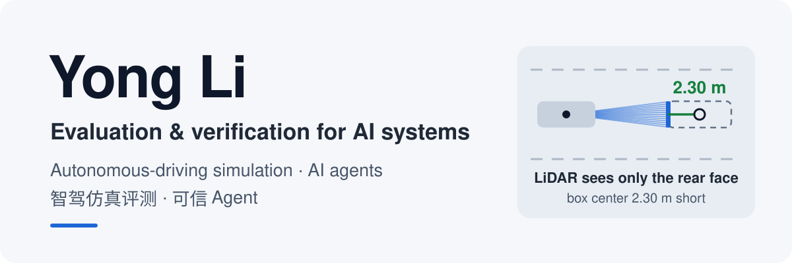

<picture>
  <source media="(prefers-color-scheme: dark)" srcset="assets/banner-dark.svg">
  
</picture>

### I build evaluation and verification tools for AI systems, from closed-loop driving simulation to fact-checked AI agents.

我做 AI 系统的评测与验证：自动驾驶闭环仿真、感知指标，以及答案可核查的 AI Agent。

One rule across all of it: **a result counts only if it is measured and traceable to evidence.** Core algorithms are written by hand, tests are checked against hand-computed numbers, and every claim in a README comes with the run that produced it.

---

## Autonomous driving · 自动驾驶仿真与评测

<table>
<tr>
<td width="50%" valign="top">
<h3><a href="https://github.com/chasen2041maker/highway-sim-eval">highway-sim-eval</a></h3>

<b>Closed-loop simulation and evaluation platform on CARLA 0.9.16</b>

基于 CARLA 的智驾仿真评测与数据闭环平台

<ul>
<li>Driving stack from scratch: kinematic bicycle model, PID with anti-windup, Pure Pursuit, IDM car following</li>
<li>LiDAR pipeline on a simulated 32-beam scan: ground removal, DBSCAN, boxes, then detection metrics at nuScenes gates (recall <b>0.40 / 0.60 / 1.00</b> at 0.5 / 2 / 4 m)</li>
<li>In CARLA: anti-windup cuts the 8 m/s overshoot from 9.46 to 8.11 m/s; IDM through a speed loop keeps a 4.91 m minimum gap in a hard-braking scenario</li>
<li><b>52</b> unit tests and step-by-step interactive explainers</li>
</ul>

<code>Python</code> <code>CARLA</code> <code>NumPy</code> <code>scikit-learn</code> <code>pytest</code>

</td>
<td width="50%" valign="top">
<h3><a href="https://github.com/chasen2041maker/Bev">Bev</a></h3>

<b>BEV perception from first principles, in 19 lessons</b>

从针孔相机到 BEV、占用网络和端到端

<ul>
<li>Pinhole projection → LSS → BEVFormer → sparse queries (Sparse4D) → occupancy → end-to-end (UniAD, SparseDrive)</li>
<li>Every lesson: one interactive animation, hand-written core functions, tests checked against hand computation and KITTI calibration</li>
<li>Roadmap ends with a mini BEV model trained on CARLA multi-camera data and plugged back into highway-sim-eval</li>
</ul>

<code>PyTorch</code> <code>NumPy</code> <code>KITTI</code> <code>CARLA</code>

</td>
</tr>
</table>

## AI agents · Agent 评测与可信运行

<table>
<tr>
<td width="50%" valign="top">
<h3><a href="https://github.com/chasen2041maker/GroundGuard">GroundGuard</a></h3>

<b>Deterministic fact gate for tool-using agents</b>

Agent 答案的确定性事实校验，不用 LLM 当裁判

<ul>
<li>Numeric claims must trace back to tool results recorded in the same run</li>
<li>Benchmark: catches <b>71 / 71</b> expected failures on a 200-case bilingual dataset, <b>0</b> false positives</li>
<li>On <a href="https://pypi.org/project/groundguard-ai/">PyPI</a> with a <a href="https://chasen2041maker.github.io/GroundGuard/">docs site</a>; works with OpenAI, LangChain, LangGraph, PydanticAI</li>
</ul>
</td>
<td width="50%" valign="top">
<h3><a href="https://github.com/chasen2041maker/AgentTrust-Runtime">AgentTrust-Runtime</a></h3>

<b>Policy, approvals and verifiable evidence for agent tool calls</b>

Agent 工具调用的策略、审批与证据链

<ul>
<li>Fail-closed controls around OpenAI Agents, LangGraph, Pydantic AI, MCP or plain Python tools</li>
<li>Human approval that survives restarts and replays the original arguments</li>
<li>Hash-chained evidence log, verifiable per run</li>
</ul>
</td>
</tr>
<tr>
<td width="50%" valign="top">
<h3><a href="https://github.com/chasen2041maker/BidRadar">BidRadar</a></h3>

<b>Evidence-first research agent for public tenders</b>

证据优先的招投标研究 Agent

<ul>
<li>Five fixed pipeline steps with per-claim verification and program checks, instead of one large tool loop</li>
<li>Every conclusion quotes the source text; unknown stays "to verify"</li>
<li>Cost ledger with three budget levels; workers resume from checkpoints without paying twice</li>
</ul>

<code>FastAPI</code> <code>GitHub Actions</code>

</td>
<td width="50%" valign="top">
<h3><a href="https://github.com/chasen2041maker/research-forge">research-forge</a></h3>

<b>Turn research ideas into reproducible experiments</b>

把研究想法变成可复现、可审计的实验

<ul>
<li>A frozen spec (paper hash, git commit, Docker image digest, command, metrics) runs in a locked-down container</li>
<li>Outputs <code>VERIFIED</code> only when code, metrics and evidence all match</li>
<li>Multi-agent research studio upstream, evidence-gated runtime downstream</li>
</ul>
</td>
</tr>
</table>

---

**Toolbox** · Python · NumPy · PyTorch · scikit-learn · CARLA · pytest · FastAPI · LangGraph · Docker · TypeScript

**Learning now** · multi-object tracking (Kalman filter + Hungarian matching) · BEV perception · C++ · ROS 2

**Background** · M.S., UNSW Sydney · backend and AI-agent engineer
