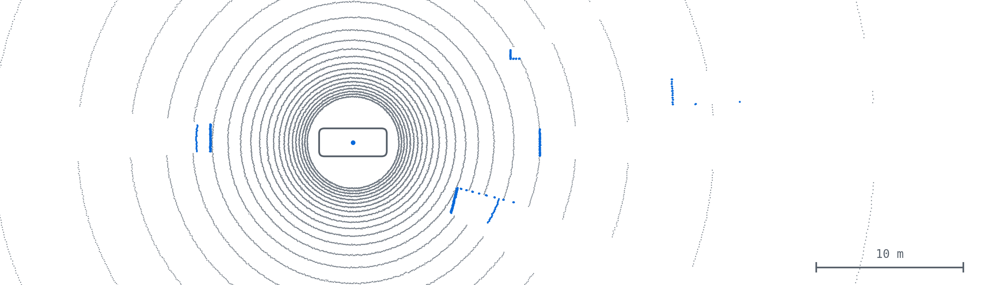

<picture>
  <source media="(prefers-color-scheme: dark)" srcset="assets/scan-dark.png">
  
</picture>

<i>One LiDAR sweep from <a href="https://github.com/chasen2041maker/highway-sim-eval">highway-sim-eval</a>, seen from above.</i>

<b>中文版：点这里展开</b>

## 你好，我是 Yong Li

后端和 AI Agent 工程师，悉尼 UNSW 人工智能硕士（本科生物工程）。业余时间从零写一套自动驾驶系统，放进 CARLA 仿真器里测。顶部的图是这个项目里假激光雷达扫的一圈，从上往下看。

### 最近在做

- **2026-10** · 激光雷达目标跟踪，卡尔曼滤波（进行中）。直接用相邻两帧算车速，最多差 5.5 m/s。
- **2026-10** · 4% 上坡上去地面：固定高度切出 3371 个假障碍物，RANSAC 拟合地面后为 0。
- **2026-10** · 给 highway-sim-eval 加了 CI，第一次运行就查出 `requirements.txt` 漏了依赖。

### 项目

- **[highway-sim-eval](https://github.com/chasen2041maker/highway-sim-eval)** · 从零写的驾驶系统（控制、跟车、激光雷达感知、跟踪），在 CARLA 0.9.16 里闭环测。54 个测试，每次 push 自动跑 · [交互动画讲解](https://chasen2041maker.github.io/highway-sim-eval/)
- **[Bev](https://github.com/chasen2041maker/Bev)** · 写给自己的 BEV 感知课程，19 课，目前暂停。
- AI Agent 方向的项目（GroundGuard、AgentTrust-Runtime、BidRadar、research-forge）在下面的置顶里。

### 联系

2027 年在看自动驾驶仿真、评测、数据平台方向的岗位（上海、杭州）。chasen2041@gmail.com

## Hi, I'm Yong Li

Backend and AI-agent engineer with a master's in AI from UNSW Sydney (bioengineering before that). In my spare time I'm building an autonomous-driving stack from scratch and testing it in the CARLA simulator.

### Now

- **Oct 2026** · Kalman filter for LiDAR tracking (in progress). Speed from two-frame differences was off by up to 5.5 m/s.
- **Oct 2026** · Ground removal on a 4% slope: a fixed height cut made 3,371 false obstacles; a RANSAC ground plane made 0.
- **Oct 2026** · Added CI to highway-sim-eval. The first run caught a dependency missing from `requirements.txt`.

### Projects

- **[highway-sim-eval](https://github.com/chasen2041maker/highway-sim-eval)** · Driving stack written from scratch (control, car following, LiDAR perception, tracking), run closed-loop in CARLA 0.9.16. 54 tests on CI · [interactive explainers](https://chasen2041maker.github.io/highway-sim-eval/)
- **[Bev](https://github.com/chasen2041maker/Bev)** · A 19-lesson BEV perception course I'm writing for myself. Paused for now.
- My AI-agent projects (GroundGuard, AgentTrust-Runtime, BidRadar, research-forge) are pinned below.

### Contact

Looking for autonomous-driving simulation, evaluation or data-platform roles in 2027 (Shanghai or Hangzhou). chasen2041@gmail.com
