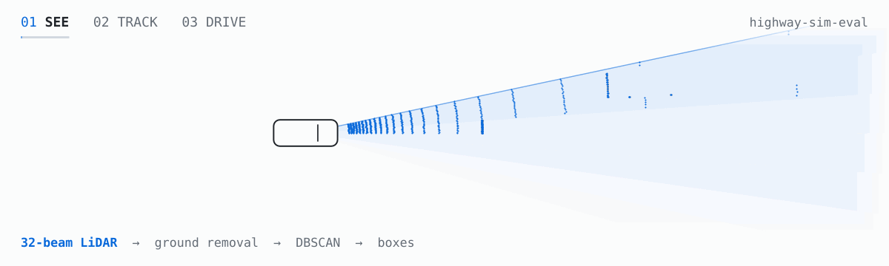

<picture>
  <source media="(prefers-color-scheme: dark)" srcset="assets/banner-dark.gif">
  
</picture>

<i>See → track → drive: every frame computed by the code in <a href="https://github.com/chasen2041maker/highway-sim-eval">highway-sim-eval</a>.</i>

<b>中文版：点这里展开</b>

## 你好，我是 Yong Li

后端和 AI Agent 工程师，悉尼 UNSW 人工智能硕士（本科生物工程）。业余时间从零写一套自动驾驶系统，放进 CARLA 仿真器里测。顶部的动图是这个项目的代码一帧一帧算出来的：雷达扫一圈、分出物体（SEE）→ 多车跟踪，被挡住也不丢编号（TRACK）→ 判断能不能变道、画曲线、跟着开过去（DRIVE）。

### 最近在做

- **2026-10** · 开始做仿真评测：同一个跟车司机（IDM）、同一道前车急刹，从我自己写的模型换到 HighwayEnv，最猛刹车就从 −3.69 变成 −3.44。司机没变，是两个模拟器更新的先后顺序不同（先减速再挪 vs 先挪再减速）。
- **2026-10** · 把真值换成激光雷达：雷达框 → 跟踪 → 挑前车 → 跟车。没撞，最小车距也差不多，但最后一脚刹车猛了 54%（−6.88 vs −4.46 m/s²）：前车刹车晚了约 1 秒才被看出来（卡尔曼滞后、进弯后框中心往前滑、编号换了一次）。
- **2026-10** · 多目标跟踪：卡尔曼滤波 + 匈牙利匹配 + 编号管理，自己手写并对着真值打分，又用 C++ 重写了一遍（CMake + googletest），整段逐帧和 Python 版一致。车被挡住 0.5 秒，轨迹等 10 帧编号不变，只等 3 帧就会换成新编号。

### 项目

- **[highway-sim-eval](https://github.com/chasen2041maker/highway-sim-eval)** · 从零写的驾驶系统（控制、跟车、激光雷达感知、跟踪、变道），在 CARLA 0.9.16 里闭环测，正在加场景评测。104 个 Python + 21 个 C++ 测试，每次 push 自动跑 · [交互动画讲解](https://chasen2041maker.github.io/highway-sim-eval/)
- **[Bev](https://github.com/chasen2041maker/Bev)** · 写给自己的 BEV 感知课程，19 课，目前暂停。
- AI Agent 方向的项目（GroundGuard、AgentTrust-Runtime、BidRadar、research-forge）在下面的置顶里。

### 联系

2027 年在看自动驾驶仿真、评测、数据平台方向的岗位（上海、杭州）。chasen2041@gmail.com

## Hi, I'm Yong Li

Backend and AI-agent engineer with a master's in AI from UNSW Sydney (bioengineering before that). In my spare time I'm building an autonomous-driving stack from scratch and testing it in the CARLA simulator.

### Now

- **Oct 2026** · Starting on simulation evaluation: the same IDM driver on the same hard-braking scenario braked at −3.69 m/s² in my own model and −3.44 in HighwayEnv. The driver didn't change; the two simulators update in a different order (brake then move vs move then brake).
- **Oct 2026** · LiDAR in the loop: boxes → tracker → lead car → car following. No crash and about the same minimum gap, but the last brake was 54% harder (−6.88 vs −4.46 m/s²): the lead's braking was seen about 1 s late (Kalman lag, the box centre sliding forward in the bend, one ID switch).
- **Oct 2026** · Multi-object tracking: Kalman filter + Hungarian matching + track IDs, hand-written and scored against ground truth, then ported to C++ (CMake + googletest), matching the Python version frame by frame. A car hidden for 0.5 s keeps its ID if tracks wait 10 frames; with 3 frames it comes back under a new one.

### Projects

- **[highway-sim-eval](https://github.com/chasen2041maker/highway-sim-eval)** · Driving stack written from scratch (control, car following, LiDAR perception, tracking, lane change), run closed-loop in CARLA 0.9.16, now growing a scenario-evaluation layer. 104 Python + 21 C++ tests on CI · [interactive explainers](https://chasen2041maker.github.io/highway-sim-eval/)
- **[Bev](https://github.com/chasen2041maker/Bev)** · A 19-lesson BEV perception course I'm writing for myself. Paused for now.
- My AI-agent projects (GroundGuard, AgentTrust-Runtime, BidRadar, research-forge) are pinned below.

### Contact

Looking for autonomous-driving simulation, evaluation or data-platform roles in 2027 (Shanghai or Hangzhou). chasen2041@gmail.com
